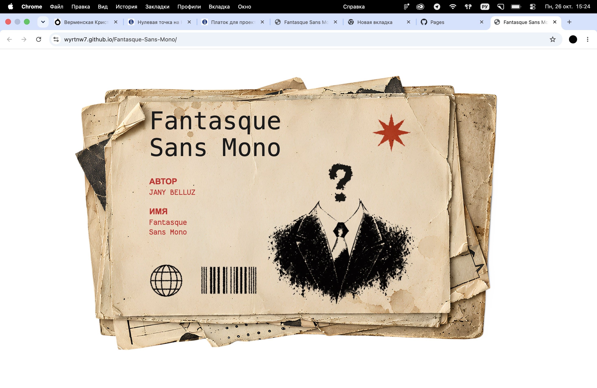

# Fantasque Sans Mono

Сайт-презентация, посвященный моноширинному шрифту Fantasque Sans Mono. Проект рассказывает об истории шрифта, его особенностях и сферах применения.

## Ссылка на сайт

https://wyrtnw7.github.io/Fantasque-Sans-Mono/

## Скриншот

## Автор

Верменская Кристина, группа Б26Д309

## Что я научилась делать

- Разобралась, как подключать локальные шрифты (файлы .ttf`) через директиву `@font-face в CSS, чтобы они отображались у всех пользователей.
- Научилась использовать Flexbox (`display: flex`) для выравнивания элементов в один ряд (например, для карточек и текста рядом с иконками).
- Поняла, как накладывать текст поверх картинки с помощью position: absolute и z-index, чтобы текст не ломал общую сетку сайта.
- Отработала навык публикации сайта на GitHub Pages и работы с GitHub Desktop.

## Использование ИИ

### Инструменты

| Инструмент | Для чего использовал(а) | Уровень помощи |
| -——— | ———————— | ————— |
| ChatGPT | Объяснял, как работают (CSS) свойства и помогал найти ошибки в путях к картинкам и настройке позиционирования. | 2 |

### Записи о запросах

#### Запись №1

- Что я хотела сделать: Сверстать слайды по макету из Figma, чтобы сайт выглядел как единый длинный постер, и сделать так, чтобы текст не вылезал за края.
- Что я спросила: «Почему картинки не загружаются и как сделать, чтобы текст не вылезал за края?»
- Что ответил ИИ: Указал на ошибку в пути к файлам и подсказал использовать display: flex с правильными отступами.
- Что я изменила: Я сама исправила пути к картинкам, подобрала свои размеры шрифтов и настроила отступы под свой макет.
- Как я поняла, что это работает: Открыла в браузере, проверила, что на больших и маленьких экранах ничего не съезжает.

#### Запись №2

- Что я хотела сделать: Правильно расположить текст и иконки на 4-м слайде, а также выровнять карточки на 7-м слайде.
- Что я спросила: «Как наложить текст поверх картинки и выровнять элементы в ряд?»
- Что ответил ИИ: Подсказал, что для наложения нужно использовать position: relative для родителя и position: absolute для текста.
- Что я изменила: Я сама подбирала координаты top и left в процентах для каждого текстового блока на 4-м и 8-м слайдах, чтобы они идеально встали на свои места.
- Как я поняла, что это работает: Обновляла страницу в браузере и проверяла, совпадает ли расположение с макетом в Figma.

### Выводы

ИИ немного помогал на этапе, когда я не понимала, почему элементы «разваливаются» или почему картинка не грузится. Также он объяснял сложные моменты с position: absolute. Ошибался ИИ в основном в мелочах: иногда предлагал сложные решения, которые ломали мою структуру, или путался в путях к файлам. Я замечала это, когда проверяла результат в браузере, и исправляла вручную. Сейчас я сама хорошо понимаю, как задавать размеры, отступы, подключать шрифты и выравнивать элементы.

## Особенности верстки (сверх базового курса)

В ходе работы я использовала несколько подходов, которые не разбирались на базовых уроках, чтобы сайт выглядел точно как макет:

1. Позиционирование (`position: absolute` и `relative`) — использовала для наложения текста поверх картинок (на 1-м, 4-м и 7-м слайдах) и для размещения звездочек. Родительскому блоку задавала relative, а самому тексту — absolute.
2. Фоны (`background-image`) — применила для чемодана на 5-м слайде и для картонки на 3-м, чтобы легко управлять размерами (`background-size: contain`) и положением картинки.
